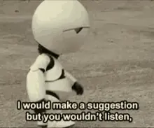

Um livro que eu gostaria de reler qualquer dia desses é "O Guia do Mochileiro das Galáxias", do britânico Douglas Adams. Nele o autor descreve um dos meus personagens favoritos, o depressivo robô *Marvin*.

Criado pela *Sirius Cybernetics Corporation*, ele possui um exclusivo recurso ainda em produção chamado *Genuine People Personalities*, "personalidades humanas genuínas". A ideia era dar emoções aos robôs (ou simular muito bem), o que acabou resultando na personalidade melancólica do androide. Umas das falas mais marcantes do personagem é:

> – Vamos – disse ele. – Me mandaram buscar vocês e levá-los até a ponte de comando. Pois é. Eu, com um cérebro do tamanho de um planeta, e eles me mandam buscar vocês e levar até a ponte de comando. Que tal isso como realização profissional?



O conceito de uma mente (ou algo parecido) tão extraordinária como aquela, fazendo as tarefas mais trivais possíveis, combina perfeitamente com a personalidade depressiva vinda de fábrica. E, infelizmente, cabe muito bem em como alguns recursos que existem hoje são usados de forma tão banais como nunca antes foi visto.

Historicamente, o debate sobre o acesso ao conhecimento sempre volta para um mesmo ponto com o seguinte ciclo:

```{mermaid}
flowchart LR
  A[Meio de informação em voga] --> B[Revolução tecnológica]
  B --> C[Novo meio de informação]
  C -- torna-se --> A
```

"Hoje com a internet, as pessoas podem acessar o conhecimento mais facilmente". Esse afirmação, bem difundida até, também foi verdade no advento dos telecursos de TV; e foi dita novamente quando os cursos a distância surgiram via rádio e correio; e se voltarmos o suficientemente pode-se dizer que ela seria uma verdade desde a criação da prensa.

O que podemos perceber com o passar do tempo é que o conhecimento humano possui a tendência de ser produzido em maiores volumes e difundido cada vez mais rapidamente com o passar do tempo. 

# Conhecimento x Ação

A revolução da IA difere um pouco dessa tendência, uma IA não é um novo meio de se produzir conhecimento — visto que ela se utiliza de informações previamente criadas por humanos — e muito menos é um meio de disseminação. Ao contrário dessas duas definições que adotamos, os *chats* são máquinas de **agência**.

:::{.callout-note}
E somente para deixar uma coisa clara antes de prolongar o texto, eu pessoalmente uso vários recursos de IA no meu cotidiano. Não sou uma pessoa que é contra uma IA por puro capricho ou teimosia, mas dados os recursos naturais e problemas gerados atualmente por causa dela, eu fico com um pouco de incômodo ao ver tanto slop inútil sendo produzido.
:::

Segundo o dicionário Michaelis @michaelis_agencia, um dos significados da palavra agência é: *Capacidade de atuação, de exercer tarefa; atividade, diligência*. Ao contrário de um meio de comunicação ou ferramenta de busca, que são completamente passivos no processo de busca da informação e construção do conhecimento, uma IA pode ativamente efetuar essas tarefas tão bem quanto um ser humano (dentro das suas limitações).

Portanto um agente, um atuador, vai poder obter informação e ajudar na execução de tarefas de forma quase autônoma. A revolução da IA não se traduz em uma mudança no meio de informação, mas no agente ativo que constrói essa informação.

# O que é uma IA afinal?

A história da inteligência artificial é longa e extensa, me faltará aqui espaço e conhecimento suficientes para explorar esse assunto de forma minusciosa. O que proponho aqui é explicar o que ela não é.

Vez em quando sai na mídia uma manchete como "Engenheiro de tal empresa desligou uma IA pois essa estava fazendo XYZ", sendo 'XYZ' normalmente substituído por 'ganhando consciência'; 'pensando em se matar'; 'planejando o fim da raça humana' ou alguma variação do tipo. Algo bem sensacionalista e que chama atenção.

Então, tirando o primeiro elefante da sala, uma IA não pensa. Ponto. O raciocínio como ação deriva da atividade biológica do cérebro humano, que é modulado por neurotransmissores, inputs do ambiente, contato com outros humanos, noção espacial e temporal, sono, cansaço, fome, raiva, etc. Pensar por si só é um ato humano justamente por estarmos em corpos humanos. Baleias e cães pensam também, mas eles possuem estruturas biológicas diferentes, sentidos diferentes, vivem em ambientes diferentes e interagem com indivíduos diferentes, logo sua forma de pensar é extremamente diferente. Estou ilustrando esses exemplos para dizer que pensar é uma propriedade de seres que possuem um sistema nervoso muito bem desenvolvido e trocam contato e informações com tudo e todos que interagem, percebendo via input em seu corpo físico.

Um modelo de linguagem (que nos referimos como IA) não possui corpo físico, nem sistema nervoso, não interage com o ambiente ou com outros indivíduos. A cognição como nós conhecemos é uma propriedade exclusiva de seres biológicos.

## O que um LLM 'pensa'

Uma IA, ou chamando da forma correta — um LLM (Large Language Model, "Modelo grande de linguagem") – 'pensa' a partir de uma série de operações matemáticas envolvendo sua unidade básica de linguagem: os **tokens**. Um token não é uma sílaba, nem uma palavra inteira, é o menor elemento de um banco de dados que permite a predição dos próximos que virão a seguir. 

As LLMs, de forma bem grosseira, são como as funções de auto-completar do teclado de celulares, mas com recursos computacionais de escalas astronômicas. O objetivo de uma IA é predizer o próximo token baseado no contexto dado de todos os tokens anteriores. 

**Esse artigo está incompleto**


